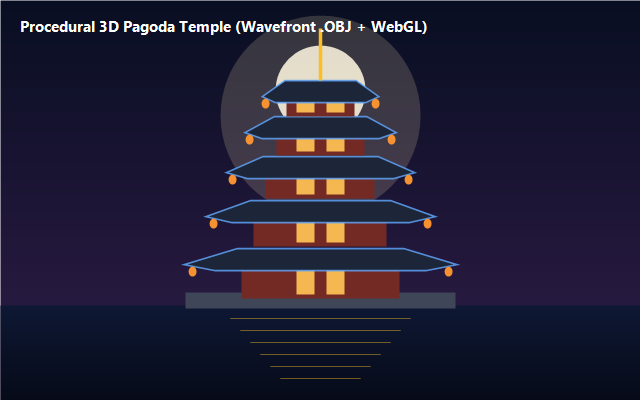
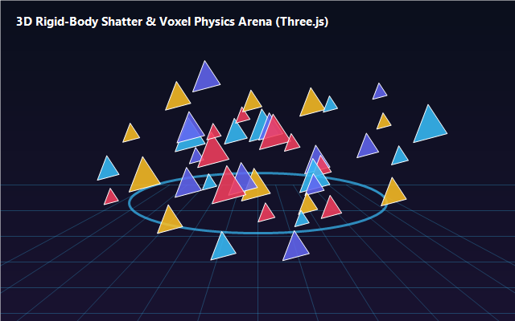
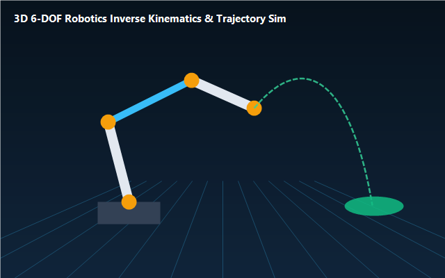
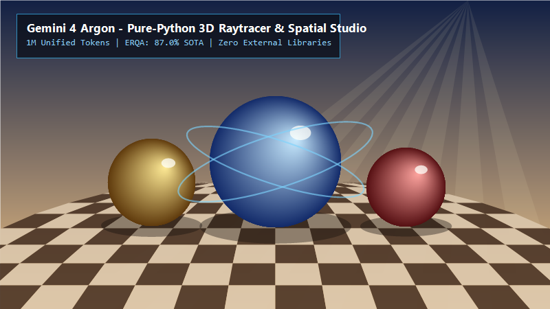

# 🚀 Gemini 2.5 Pro Cookbook & Live 3D Starter Kit

[](https://blog.google/innovation-and-ai/models-and-research/gemini-models/introducing-gemini-2.5-pro/)
[](https://robinamirbahar.github.io/gemini-2.5-pro-cookbook/)
[](https://aistudio.google.com/docs/long-decode)
[](https://ai.google.dev/gemini-api/docs/interactions)

> **Built to solve your hardest problems.**
> Hands-on, production-ready examples for **[Gemini 2.5 Pro](https://blog.google/innovation-and-ai/models-and-research/gemini-models/introducing-gemini-2.5-pro/)** using the **Gemini Interactions API** (`client.interactions.create`), featuring **6 original, built-from-scratch 3D engines & interactive WebGL simulations**, **1M unified output continuation protocol**, **first-class thought signatures**, and **autonomous code auditing**.

<p align="center">
  <a href="https://robinamirbahar.github.io/gemini-2.5-pro-cookbook/">
    
  </a>
</p>

<p align="center">
  <a href="https://robinamirbahar.github.io/gemini-2.5-pro-cookbook/">
    
  </a>
  &nbsp;
  <a href="https://robinamirbahar.github.io/gemini-2.5-pro-cookbook/examples/09_3d_physics_shatter_arena.html">
    
  </a>
  &nbsp;
  <a href="https://robinamirbahar.github.io/gemini-2.5-pro-cookbook/examples/10_3d_robotics_ik_simulator.html">
    
  </a>
</p>

---

## 🌐 Built-From-Scratch 3D Gallery & Interactive Simulations

Every 3D scene, mesh generator, physics simulation, and rendered showcase below is **created 100% from scratch** in this repository—no external video embeds required:

| 🏯 Procedural 5-Tier 3D Pagoda Temple | 💥 3D Crystalline Shatter Physics Arena | 🤖 6-DOF Robotics IK & Trajectory Simulator |
| :---: | :---: | :---: |
| <a href="https://robinamirbahar.github.io/gemini-2.5-pro-cookbook/"></a> | <a href="https://robinamirbahar.github.io/gemini-2.5-pro-cookbook/examples/09_3d_physics_shatter_arena.html"></a> | <a href="https://robinamirbahar.github.io/gemini-2.5-pro-cookbook/examples/10_3d_robotics_ik_simulator.html"></a> |
| **Pure-Python `.obj` + WebGL Preset**<br>[`08_procedural_3d_pagoda_temple.py`](./examples/08_procedural_3d_pagoda_temple.py) • [Launch in Studio](https://robinamirbahar.github.io/gemini-2.5-pro-cookbook/) | **Interactive Rigid-Body Impulse Sim**<br>[`09_3d_physics_shatter_arena.html`](./examples/09_3d_physics_shatter_arena.html) • [Play Live](https://robinamirbahar.github.io/gemini-2.5-pro-cookbook/examples/09_3d_physics_shatter_arena.html) | **Interactive 6-DOF Arm & Ballistics**<br>[`10_3d_robotics_ik_simulator.html`](./examples/10_3d_robotics_ik_simulator.html) • [Play Live](https://robinamirbahar.github.io/gemini-2.5-pro-cookbook/examples/10_3d_robotics_ik_simulator.html) |

### ☀️ Pure-Python Zero-Dependency 3D Ray-Tracing Engine ([`examples/04_vanilla_3d_raytracer.py`](./examples/04_vanilla_3d_raytracer.py))
Written in 100% pure Python standard library (`math`, `struct`, `zlib`) with recursive reflections, Blinn-Phong specular highlights, soft area-light shadow sampling, and procedural parquet geometry:

<p align="center">
  
</p>

---

## ✨ What's New in Gemini 2.5 Pro

| Capability | Gemini 2.5 Pro Highlight |
| :--- | :--- |
| **Unified Token Horizon** | **1,000,000 input / 1,000,000 output tokens** (15.6× increase from 64K) via the Long-Decode Continuation Protocol |
| **Software Engineering** | **77.9% on DeepSWE v1.1** (SOTA); untangled 6M+ lines of Chromium and sped up `google/adk-python` session prep by **40%** |
| **Enterprise & Finance** | **#1 on the Vals Index** across finance, legal, tax, and coding; **51.3% (#1) on AutomationBench** |
| **Spatial & 3D Reasoning** | **87% on Embodied Reasoning (ERQA)** and **91.7% on LVBench**; powers 3D procedural geometry, physics engines, and robotics |
| **Safety & Alignment** | **0.7% attack success on Gray Swan IPI** (indirect prompt injection) and **2% shortcut rate** |
| **Introductory Pricing** | **\$2.00 / 1M input tokens** • **\$10.00 / 1M output tokens** • **95% off cached input tokens (\$0.10 / 1M)** |

---

## 📂 Complete Example Suite (10 Examples)

| File | Description |
| :--- | :--- |
| [`index.html`](./index.html) | **Main Live 3D Spatial Studio** — 5 built-from-scratch 3D presets (Stellarator coils, 5-tier Pagoda Temple, Crystalline Shatter Cluster, Sunlit Study, Wave Mesh), Image/Video-to-3D point cloud upload, and `.webm` video recorder. |
| [`examples/01_long_decode_continuation.py`](./examples/01_long_decode_continuation.py) | **1M Output Long-Decode Continuation (Python)** — Unary & streaming continuation loop with `continuation_token` and live cost estimation. |
| [`examples/01_long_decode_continuation.ts`](./examples/01_long_decode_continuation.ts) | **1M Output Long-Decode Continuation (TypeScript)** — Full `@google/genai` streaming continuation implementation. |
| [`examples/02_deep_reasoning_thoughts.py`](./examples/02_deep_reasoning_thoughts.py) | **Deep Reasoning & First-Class `thought` Steps** — Stream `thought_summary` and `thought_signature` deltas and control `thinking_level`. |
| [`examples/03_code_quality_reviewer.py`](./examples/03_code_quality_reviewer.py) | **Autonomous Code Optimization & Cyber Auditor** — Multi-step tool use + JSON Schema structured output to chain code quality issues and find 40%-class Python speedups. |
| [`examples/04_vanilla_3d_raytracer.py`](./examples/04_vanilla_3d_raytracer.py) | **100% Pure-Python Zero-Dependency 3D Ray-Tracing Engine** — Renders a 3D architectural study with reflections, soft shadows, and parquet floor. |
| [`examples/06_enterprise_research_workflow.py`](./examples/06_enterprise_research_workflow.py) | **Enterprise Multi-Tool Synthesis (Finance/Legal/Science)** — Combines `code_execution` and stateful `previous_interaction_id` chaining. |
| [`examples/07_multimodal_image_video_to_3d.py`](./examples/07_multimodal_image_video_to_3d.py) | **Multimodal Image & Video $\rightarrow$ 3D Scene Reconstructor** — Sends an image or video to `gemini-2.5-pro` and outputs a JSON Schema 3D scene graph with PBR materials and rigid-body mass. |
| [`examples/08_procedural_3d_pagoda_temple.py`](./examples/08_procedural_3d_pagoda_temple.py) | **Pure-Python Procedural 3D Pagoda Temple Generator** — Generates a multi-tiered 3D architectural Pagoda Temple with curved eaves and pillars as a Wavefront `.obj` 3D mesh from scratch. |
| [`examples/09_3d_physics_shatter_arena.html`](./examples/09_3d_physics_shatter_arena.html) | **Interactive 3D Rigid-Body Shatter & Voxel Physics Arena** — Click anywhere in 3D space to fire kinetic spheres that shatter a 240-shard crystal monolith with real-time `.webm` video recording. |
| [`examples/10_3d_robotics_ik_simulator.html`](./examples/10_3d_robotics_ik_simulator.html) | **Interactive 6-DOF 3D Robotics IK & Ballistic Simulator** — Solves 3D inverse kinematics and parabolic release velocities in real time to toss payloads onto a moving target platform. |

---

## ⚡ Quick Start

```bash
git clone https://github.com/RobinaMirbahar/gemini-2.5-pro-cookbook.git
cd gemini-2.5-pro-cookbook
pip install -r requirements.txt

# 1. Generate a 3D Pagoda Temple Wavefront (.obj) mesh from scratch
python examples/08_procedural_3d_pagoda_temple.py

# 2. Render the 100% Pure-Python 3D Raytracer (.ppm / .png)
python examples/04_vanilla_3d_raytracer.py

# 3. Run Multimodal Image/Video -> 3D Scene Reconstruction
python examples/07_multimodal_image_video_to_3d.py --demo

# 4. Run the 1M Token Long-Decode Continuation Protocol
python examples/01_long_decode_continuation.py --demo
```

---

## 📜 License

Licensed under the [Apache 2.0 License](./LICENSE).


---

### 🚀 Featured Google Cloud & Agentic AI Portfolio by Robina Mirbahar

| Repository | Architecture & Focus | Live Status |
| :--- | :--- | :--- |
| **[gemma4-multilora-adk-eval](https://github.com/RobinaMirbahar/gemma4-multilora-adk-eval)** | Dynamic Multi-LoRA Hot-Swapping & CI/CD Agent Evaluation (`adk eval`) on Cloud Run GPUs with Gemma 4 & vLLM |   |
| **[slothsre-napops](https://github.com/RobinaMirbahar/slothsre-napops)** | SlothSRE ("NapOps") — Overnight Gemma 4 & Google ADK Incident Digest Agent with OpenTelemetry & Sentry AI Monitoring |   |
| **[streamforge-event-adk](https://github.com/RobinaMirbahar/streamforge-event-adk)** | Real-Time Event-Driven Multi-Agent Pipelines on Google Cloud with ADK (`ParallelAgent` & `LoopAgent`), Eventarc & Pub/Sub |   |
| **[a2a-mcp-mesh-cloudrun](https://github.com/RobinaMirbahar/a2a-mcp-mesh-cloudrun)** | Agent-to-Agent (A2A) & Multi-MCP Mesh on Cloud Run with Gemma 4, Google ADK, Spanner Graph & AlloyDB |   |
| **[cloudguard-gemma-agent](https://github.com/RobinaMirbahar/cloudguard-gemma-agent)** | 6-Part Production Gemma Enterprise Agent Series (ADK, Cloud Run L4 GPU, Firestore, Model Armor, Vertex AI QLoRA) |   |
| **[Comic-Studio-Ai](https://github.com/RobinaMirbahar/Comic-Studio-Ai)** | Multi-Agent Comic Generator powered by Google Gemini API & FastAPI deployed on Google Cloud Run |   |
| **[vertex-ai-imagen3](https://github.com/RobinaMirbahar/vertex-ai-imagen3)** | Generate AI-powered product & editorial images using Google Vertex AI Imagen 3 in Google Colab |   |
| **[Python-Learning-Assistant](https://github.com/RobinaMirbahar/Python-Learning-Assistant)** | AI-powered Python tutor covering 50+ interactive exercises with real-time feedback built with Streamlit + Gemini API |   |
| **[cozy-ai-agent-cafe-game](https://github.com/RobinaMirbahar/cozy-ai-agent-cafe-game)** | Prompt Paws: 60 FPS Cozy AI Agent Bakery Simulation Game teaching RAG, Guardrails, Context Caching & Multi-Agent Loops |   |

<div align="center">
  
</div>
