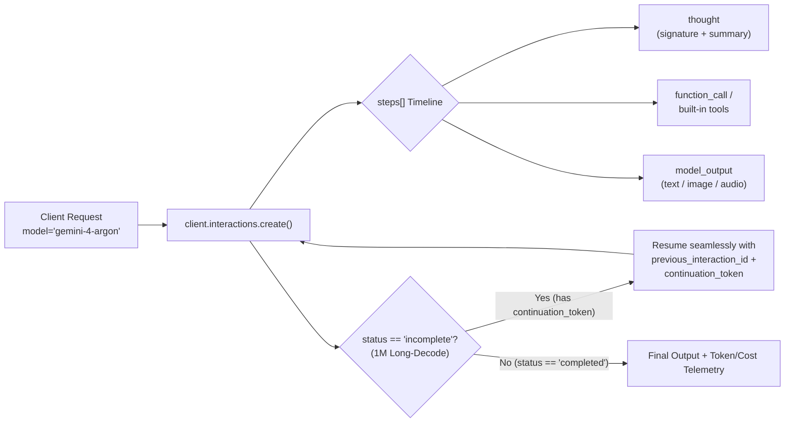

# 🚀 Gemini 4 Argon Cookbook & Starter Kit

[](https://blog.google/innovation-and-ai/models-and-research/gemini-models/introducing-gemini-4-argon/)
[](https://aistudio.google.com/docs/long-decode)
[](https://ai.google.dev/gemini-api/docs/interactions)
[](./LICENSE)

> **Built to solve your hardest problems.**
> Hands-on, production-ready examples for **[Gemini 4 Argon](https://blog.google/innovation-and-ai/models-and-research/gemini-models/introducing-gemini-4-argon/)** using the new **Gemini Interactions API** (`client.interactions.create`), featuring the **1M unified output continuation protocol**, **first-class thought steps**, **autonomous code optimization & security auditing**, and **zero-dependency 3D spatial coding**.

---

## ✨ What's New in Gemini 4 Argon

Announced on [October 13, 2026](https://blog.google/innovation-and-ai/models-and-research/gemini-models/introducing-gemini-4-argon/), **Gemini 4 Argon** (`gemini-4-argon`) is Google DeepMind's frontier model built for deep, long-horizon engineering, scientific discovery, cybersecurity defense, and enterprise workflows:

| Capability | Gemini 4 Argon Highlight |
| :--- | :--- |
| **Unified Token Horizon** | **1,000,000 input / 1,000,000 output tokens** (15.6× increase from 64K) via the Long-Decode Continuation Protocol |
| **Software Engineering** | **77.9% on DeepSWE v1.1** (SOTA); used internally to untangle 6M+ lines of Chromium and speed up `google/adk-python` session prep by **40%** |
| **Enterprise & Finance** | **#1 on the Vals Index** across finance, legal, tax, and coding; **51.3% (#1) on AutomationBench** |
| **Spatial & 3D Reasoning** | **87% on Embodied Reasoning (ERQA)** and **91.7% on LVBench**; powers Video-to-Sim-to-Real robotics and zero-dependency 3D engines |
| **Safety & Alignment** | **0.7% attack success on Gray Swan IPI** (indirect prompt injection) and **2% shortcut rate** with real-time misalignment monitoring |
| **Introductory Pricing** | **\$2.00 / 1M input tokens** • **\$10.00 / 1M output tokens** • **95% off cached input tokens (\$0.10 / 1M)** *(through Nov 30, 2026)* |

---

## 🗺️ Architecture: The Gemini Interactions API + Long-Decode Protocol



---

## 📂 Repository Structure

| File | Description | Blog Post Connection |
| :--- | :--- | :--- |
| [`examples/01_long_decode_continuation.py`](./examples/01_long_decode_continuation.py) | **1M Output Long-Decode Continuation (Python)** — Unary & streaming continuation loop with `continuation_token` and live cost estimation. | [1M Unified Token Limit & Long-Decode](https://aistudio.google.com/docs/long-decode) |
| [`examples/01_long_decode_continuation.ts`](./examples/01_long_decode_continuation.ts) | **1M Output Long-Decode Continuation (TypeScript)** — Full `@google/genai` streaming continuation implementation. | [1M Unified Token Limit & Long-Decode](https://aistudio.google.com/docs/long-decode) |
| [`examples/02_deep_reasoning_thoughts.py`](./examples/02_deep_reasoning_thoughts.py) | **Deep Reasoning & First-Class `thought` Steps** — Stream `thought_summary` and `thought_signature` deltas and control `thinking_level`. | [Working Harder on Complex Problems](https://blog.google/innovation-and-ai/models-and-research/gemini-models/gemini-4-argon/#workingharder) |
| [`examples/03_security_code_auditor.py`](./examples/03_security_code_auditor.py) | **Autonomous Code Optimization & Cyber Auditor** — Multi-step tool use + JSON Schema structured output to chain security vulnerabilities and find 40%-class Python speedups. Includes an instant `--demo` mode! | [ADK Overnight Optimization & Fairwind Cyber Defense](https://blog.google/innovation-and-ai/models-and-research/gemini-models/introducing-gemini-4-argon/#complexengineering) |
| [`examples/04_vanilla_3d_raytracer.py`](./examples/04_vanilla_3d_raytracer.py) | **100% Pure-Python Zero-Dependency 3D Ray-Tracing Engine** — Renders a 3D architectural study with BVH-style primitives, reflections, soft shadows, and optional live Argon scene generation. | [Pure-Python 3D Ray-Tracing Engine Demo](https://blog.google/innovation-and-ai/models-and-research/gemini-models/introducing-gemini-4-argon/#complexengineering) |
| [`examples/05_interactive_3d_studio.html`](./examples/05_interactive_3d_studio.html) | **Interactive 3D Spatial WebGL Studio** — Single-file browser demo showcasing procedural geometry, physics-ready kinematics, and custom shaders. | [Delivering Complex 3D Visualizations](https://blog.google/innovation-and-ai/models-and-research/gemini-models/introducing-gemini-4-argon/#complexengineering) |
| [`examples/06_enterprise_research_workflow.py`](./examples/06_enterprise_research_workflow.py) | **Enterprise Multi-Tool Synthesis (Finance/Legal/Science)** — Combines `google_search`, `code_execution`, and `url_context` with stateful `previous_interaction_id` chaining. | [Transforming Critical Business Workflows](https://blog.google/innovation-and-ai/models-and-research/gemini-models/introducing-gemini-4-argon/#professionalworkflows) |

---

## ⚡ Quick Start

### 1. Clone & Set Up Environment

**Python (`google-genai >= 2.25.0`):**

```bash
git clone https://github.com/RobinaMirbahar/gemini-4-argon-cookbook.git
cd gemini-4-argon-cookbook

python -m venv .venv
# Windows (PowerShell):
.\.venv\Scripts\Activate.ps1
# macOS / Linux:
# source .venv/bin/activate

pip install -r requirements.txt
```

**TypeScript / Node.js (`@google/genai >= 2.3.0`):**

```bash
npm install
```

### 2. Configure Your API Key

Get an API key from [Google AI Studio](https://ai.google.dev/aistudio) and set `GEMINI_API_KEY`:

```bash
# macOS / Linux
export GEMINI_API_KEY="your-api-key-here"

# Windows PowerShell
$env:GEMINI_API_KEY="your-api-key-here"
```

### 3. Run the Examples (Works With or Without an API Key via `--demo`!)

Every script supports live `gemini-4-argon` API execution **and** an instant `--demo` simulation mode so you can test the full output pipeline immediately:

```bash
# 1. Run the 100% pure-Python 3D raytracer (zero dependencies, generates argon_study.bmp)
python examples/04_vanilla_3d_raytracer.py

# 2. Run the Autonomous Security & Performance Auditor (try --demo or live with GEMINI_API_KEY)
python examples/03_security_code_auditor.py --demo

# 3. Run the 1M Token Long-Decode Continuation Protocol
python examples/01_long_decode_continuation.py --demo

# 4. Stream First-Class Thought Summaries & Signatures
python examples/02_deep_reasoning_thoughts.py --demo

# 5. Run the Enterprise Multi-Tool Workflow + Pricing Telemetry
python examples/06_enterprise_research_workflow.py --demo
```

Or open [`examples/05_interactive_3d_studio.html`](./examples/05_interactive_3d_studio.html) directly in your browser to explore the interactive 3D spatial visualization!

---

## 💻 Minimal Code Snippet: Gemini 4 Argon + Interactions API

```python
from google import genai

client = genai.Client()

# Stream reasoning (thought summaries) + final output from Gemini 4 Argon
for event in client.interactions.create(
    model="gemini-4-argon",
    input="Design a lock-free ring buffer in Rust and prove why it avoids ABA hazards.",
    generation_config={
        "thinking_level": "high",
        "thinking_summaries": "auto",
    },
    stream=True,
):
    if event.event_type == "step.delta":
        if event.delta.type == "thought_summary":
            print(f"[Argon Thinking] {event.delta.text}", end="", flush=True)
        elif event.delta.type == "text":
            print(event.delta.text, end="", flush=True)
    elif event.event_type == "interaction.completed":
        print(f"\n\nTotal Tokens: {event.interaction.usage.total_tokens}")
```

---

## 🔗 Official Resources

- 📰 **Launch Blog Post**: [Gemini 4 Argon: Built to solve your hardest problems](https://blog.google/innovation-and-ai/models-and-research/gemini-models/introducing-gemini-4-argon/)
- 🔬 **Technical Overview**: [Gemini 4 Argon: our next era of frontier intelligence](https://blog.google/innovation-and-ai/models-and-research/gemini-models/gemini-4-argon/)
- 📄 **Model Card**: [Gemini 4 Argon Model Card (PDF)](https://storage.googleapis.com/deepmind-media/Model-Cards/Gemini-4-Argon-Model-Card.pdf)
- 🛠️ **Long-Decode Documentation**: [AI Studio Long-Decode Continuation Guide](https://aistudio.google.com/docs/long-decode)
- 💻 **Google Antigravity**: [antigravity.google](https://antigravity.google/)

---

## 📜 License

Licensed under the [Apache 2.0 License](./LICENSE).
